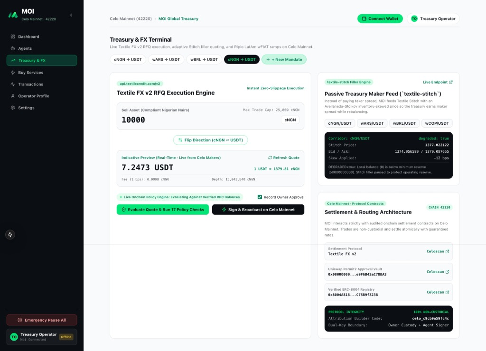
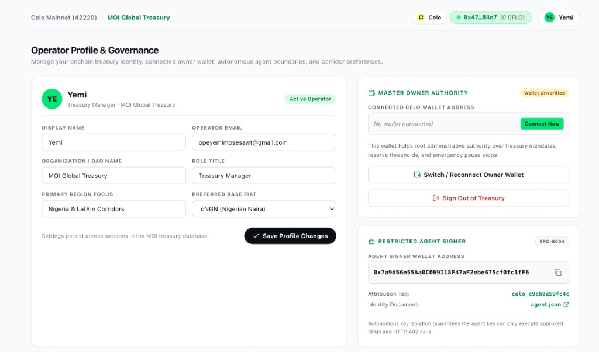
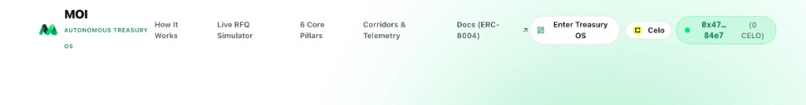

# MOI — Autonomous Treasury Operating System

MOI is an institutional, non-custodial treasury operating system and financial automation platform built natively on Celo Mainnet (`chainId: 42220`). Engineered specifically for enterprises, digital merchants, and fintech operators in high-inflation emerging markets across Africa and Latin America, MOI protects capital against rapid currency depreciation, automates institutional foreign exchange swaps, settles domestic bank transfers directly through local central clearing rails, and issues cryptographic zero-gas payment requests.

---

## Technical Verification & Testing Guide for Evaluators (Celo Mainnet)

MOI operates live on Celo Mainnet (`chainId: 42220`). Evaluators can verify system guarantees either against the deployed production endpoints or via local test execution.

### Live Production Endpoints

* Web Application (Vercel): [https://moi-theta-three.vercel.app](https://moi-theta-three.vercel.app)
* Production Alias: [https://moi-yemigraffixs-projects.vercel.app](https://moi-yemigraffixs-projects.vercel.app)
* Backend & Database Service (Railway): [https://web-production-858b2.up.railway.app](https://web-production-858b2.up.railway.app)
* Public Documentation Centre: [https://moi-theta-three.vercel.app/docs](https://moi-theta-three.vercel.app/docs)
* ERC-8004 Canonical Agent Identity: [https://moi-theta-three.vercel.app/api/identity/agent.json](https://moi-theta-three.vercel.app/api/identity/agent.json)
* Live Invoicing Checkout Route: [https://moi-theta-three.vercel.app/invoice/inv_live_test](https://moi-theta-three.vercel.app/invoice/inv_live_test)

---

### Onchain Identifiers & Verified Parameters

* Celo Mainnet Chain ID: `42220` (EVM JSON-RPC: `https://forno.celo.org`)
* Canonical Identity Registry: `0x8004A169FB4a3325136EB29fA0ceB6D2e539a432` (ERC-8004 Agent ID `#164`)
* Textile LimitOrderReactor Target: `0xa9AA0a64769cBed4d3B1Ceb4Df01CdE915C235b3`
* Permit2 Contract: `0x000000000022D473030F116dDEE9F6B43aC78BA3`
* ERC-8021 Transaction Attribution Tag: `celo_c9cb9a59fc4c` (Schema 0 suffix: `63656c6f5f633963623961353966633463110080218021802180218021802180218021`)
* Verified Hackathon Test Wallet: `0x78b7b043921EE70806c66905E31fc2D9E75455a6` (funded with CELO, USD₮, and cNGN on Celo Mainnet)

---

### Step-by-Step Technical Evaluation Workflows

#### Test 1: Cryptographic Authentication & Multi-Tenant State Isolation
1. Direct the browser to `https://moi-theta-three.vercel.app`.
2. Trigger **Connect Wallet** using MetaMask, Rabby, or Valora connected to Celo Mainnet (`chainId: 42220`).
3. Under the hood, MOI executes an EIP-4361 (Sign-In with Ethereum) challenge handshake:
   * Client calls `GET /api/auth/nonce` to obtain a cryptographically random, single-use nonce persisted with a 5-minute TTL.
   * Wallet prompts signature of the SIWE domain, URI, chain ID, and nonce.
   * Client submits the signed payload to `POST /api/auth/verify`.
   * Server validates the signature using `viem/siwe`, invalidates the nonce to prevent replay attacks, sets an `HttpOnly`, `SameSite=Strict`, `Secure` session cookie, and establishes a tenant-scoped session in PostgreSQL with row-level isolation.
4. The dashboard queries `GET /api/treasury`, executing multicall batch queries against `https://forno.celo.org` to fetch atomic onchain ERC-20 token balances and allowances across CELO, USD₮, cNGN, wBRL, wARS, and wCOP.

#### Test 2: Deterministic Policy Engine & Drift Rebalancing
1. On the dashboard, navigate to the **Target Portfolio Allocation & Rebalance Guard**.
2. Adjust the target stablecoin ratio (e.g. from `70% USD₮` to `90% USD₮`).
3. The engine evaluates portfolio drift via `calculatePortfolioDrift()`:
   $$\text{Drift} = \left|\frac{\text{Balance}_{\text{USD}\tau}}{\text{Total Portfolio Value}} - \text{Target Allocation}\right|$$
4. When drift exceeds the 5% rebalance threshold, the system computes the exact rebalance delta in base asset units.
5. Click **1-Click Rebalance**. The dashboard dispatches the parameters to the swap execution terminal, prefilling token addresses, input amounts, and calculating minimum acceptable output tokens based on the mandate's `maxSlippageBps`.

#### Test 3: Textile FX v2 RFQ Discovery & Calldata Attribution Verification
1. Open the **Treasury & FX** interface.
2. Select the trading pair (e.g., `CELO -> USD₮`, `USD₮ -> cNGN`, or `cNGN -> USD₮`) and enter an amount (e.g. `0.5`).
3. The application dispatches `POST /api/fx/quote` with the taker address, sellToken, buyToken, and amount.
4. The backend queries `https://api.textilecredit.com/v2/rfq/preview` to obtain a real-time market maker quote.
5. The 18-rule deterministic policy engine (`evaluateSwapPolicy()`) evaluates the quote against the active `TreasuryMandate`:
   * Verifies `MANDATE_NOT_PAUSED`, `PER_TRADE_CAP`, `DAILY_SELL_CAP`, `MINIMUM_RESERVE_PRESERVED`, and `APPROVED_REACTOR_TARGET` (`0xa9AA0a64769cBed4d3B1Ceb4Df01CdE915C235b3`).
   * Validates calldata integrity (`CALLDATA_AND_VALUE_GUARD`).
   * Appends the Schema 0 ERC-8021 attribution trailer (`celo_c9cb9a59fc4c`) to the transaction data.
6. Click **Execute Swap**. The user's wallet presents the transaction for onchain signature:
   * Inspect the transaction calldata in the wallet or on CeloScan to confirm the hex trailer ends with `63656c6f5f633963623961353966633463110080218021802180218021802180218021`.
   * Upon broadcast and inclusion in a Celo block, the frontend polls transaction receipt confirmation and updates live balances directly via Celo RPC.

#### Test 4: EIP-712 Zero-Gas Invoicing & Dynamic Onchain Settlement
1. Open the **Invoices & Pay** tab.
2. Click **Create New Invoice**, specify the client identifier, settlement currency (`USD₮` or `cNGN`), and invoice amount.
3. Click **Sign & Issue Invoice with Wallet ($0 Gas)**.
4. The wallet prompts an EIP-712 typed signature over the `MoiInvoice` schema (`invoiceId`, `recipient`, `amount`, `token`, `deadline`, `salt`). The invoice is cryptographically authorized with zero network gas fees.
5. Open the resulting public checkout page at `/invoice/[id]` (e.g. `https://moi-theta-three.vercel.app/invoice/inv_live_test`):
   * Inspect the dynamically generated SVG QR code (encodes the public invoice URL for scanning).
   * Click **Pay Invoice Now** to trigger an onchain ERC-20 `transfer` directly to the invoice issuer address with attribution tag appended.
   * Upon transaction receipt verification by the backend route (`GET /api/invoices/[id]`), the invoice record transitions to `PAID`, persisting the confirmed `settlementTxHash` and block timestamp in PostgreSQL.

#### Test 5: Vitest Automated Verification Suite (212 Tests across 28 Suites)
Run the automated test suite locally to verify financial invariants, restricted signer bounds, adversarial attacks, SIWE security, and live integrations:
```bash
git clone https://github.com/OpeyemiMoses/Moi.git
cd Moi
npm install
npm test
```
* Test execution time: ~38s across 28 test suites.
* Key coverage areas: `tests/adversarial/*` (first-trade authorization, policy attestation forgery, event accounting tampering), `tests/auth/*` (SIWE replay attacks, tenant isolation, session invalidation), `tests/concurrency/*` (financial race condition prevention, double-spend resistance), and `tests/audit/*` (zero mock data assertions).
*Expected Result: 28 test files passed, 212 tests passed (100% success).*

---

## Visual Platform Overview

### Autonomous Treasury Dashboard


### Zero-Gas Cryptographic Invoicing & Dynamic QR Code Payment


### Instant Onchain Settlement & Double-Entry Ledger Reconciliation


---

## The Problem: The Emerging Market Treasury Dilemma

Corporate treasuries, digital merchants, and remote enterprises operating across Africa and Latin America face compounding structural risks:

1. **Severe Currency Depreciation**: Sovereign currencies such as the Nigerian Naira (NGN), Argentine Peso (ARS), and Brazilian Real (BRL) suffer persistent inflation and devaluation. Unhedged cash balances erode operational capital monthly.
2. **P2P Counterparty & Escrow Scams**: Lacking access to institutional foreign exchange, businesses turn to informal peer-to-peer (P2P) crypto desks, exposing their bank accounts to fraudulent reversals, account freezes, and predatory 4–8% spreads.
3. **Execution Bottlenecks**: Treasury teams cannot monitor exchange rates around the clock. Manual conversions introduce delays, human error, and execution slippage during high-volatility events.
4. **Unsafe Autonomous Systems**: Traditional trading bots operate as black boxes with unconstrained private key access. A single hallucinated model output or API glitch can liquidate an entire corporate treasury.

---

## The Solution: The 6 Architectural Pillars of MOI

MOI solves these challenges by combining non-custodial asset custody, guaranteed RFQ execution, direct domestic banking rails, and deterministic risk policy enforcement:

```
[ Master Owner Custody ] (MetaMask / Rabby / MiniPay / Valora)
         │
         │  1. Non-custodial asset custody (Permit2 approvals)
         │  2. Policy rule parameter configuration
         ▼
[ Deterministic Policy Engine ] (Zero-Trust TypeScript Execution)
         │
         │  Enforces 17 Financial Invariants:
         │  - Daily trading caps
         │  - Minimum local currency reserve preservation
         │  - Maximum allowed slippage bounds
         │  - HMAC attestation verification
         ▼
[ Restricted Agent Signer ] (Backend Operational Signer)
         │
         │  Dispatches authorized transactions strictly within policy.
         │  Zero access to owner custody; cannot redirect payout targets.
         ▼
[ Celo Mainnet Settlement ] (Textile LimitOrderReactor · Chain ID 42220)
```

### 1. Dual-Key Institutional Security Model
* **Master Owner Key**: Retains absolute custody of all treasury assets. Only the master key can authorize new policy parameters, initiate first-trade allowances, or modify withdrawal allowlists.
* **Restricted Operational Signer Key**: Holds zero asset custody. Can only dispatch pre-authorized transactions through the Textile LimitOrderReactor after passing all 17 deterministic checks.
* **First-Trade Authorization**: The operational agent cannot execute any trade autonomously until the master wallet signs an explicit EIP-712 first-trade mandate for that specific corridor and contract target.
* **16-Field HMAC Attestation**: Every approved trade generates an atomic HMAC attestation binding the execution ID, treasury ID, mandate, RFQ, tokens, amounts, reactor, and calldata hash to a single-use atomic nonce.

### 2. Textile FX v2 Integration (Active Taker & Passive Maker)
* **Active Taker (`taker_rfq`)**: Requests firm, executable quotes via Textile FX v2. Orders are executed against the official `LimitOrderReactor` on Celo Mainnet with zero price slippage.
* **Passive Maker (`textile-stitch`)**: Serves an Avellaneda-Stoikov inventory-skewed pricing feed (`/api/pricing/stitch`), enabling treasuries to earn maker spread while rebalancing excess local currency reserves.
* **Protocol Fee Enforcement**: Guaranteed maximum fee compliance bounded to 1 bps routing through the Textile Fee Controller (`0x7b005466F905DD882A959888154587fA76cd3Ea7`).

### 3. Direct Domestic Bank Rails (Multi-Corridor Off-Ramps)
MOI bridges onchain stable assets directly into sovereign fiat clearing systems without intermediary P2P exchange risk:
* **Nigeria**: Direct integration pathway for NIBSS Instant Payment (NIP) settling to major banks (GTBank, Access, Zenith, Kuda, PalmPay, OPay).
* **Brazil**: Instant Brazilian Real settlements via Central Bank PIX.
* **Argentina**: Direct clearing to Argentine bank and virtual accounts via COELSA CBU, CVU, and Alias.
* **Colombia & Mexico**: Automated transfers via Colombia PSE / Nequi and Mexico SPEI CLABE.

### 4. Zero-Gas Invoicing & Payment Standard (`celo:`)
* Merchants generate structured cryptographic invoices signed via EIP-712 directly from their connected wallet.
* Invoice creation consumes **$0.00 in network gas** and produces an immutable cryptographic record.
* Generates standard `celo:` payment URIs and scannable dynamic QR codes compliant with MiniPay, Valora, and standard mobile wallets.
* Automatic payment detection reconciles customer settlements directly into the merchant's double-entry ledger.

### 5. Onchain Identity & Transaction Attribution
* **ERC-8004 Agent Trust Protocol**: Registers verifiable agent identity (`/api/identity/agent.json`) on Celo's canonical `IdentityRegistry` and `ReputationRegistry`.
* **ERC-8021 Transaction Attribution**: 100% of outgoing transactions append the official Schema 0 suffix (`0xce10` magic marker) with idempotency protection, attributing onchain volume without modifying transaction execution semantics.

### 6. Autonomous Microservices Settlement (`x402` & `buy`)
* Settles external API intelligence and data feeds over HTTP 402 using **USA₮**, **USD₮**, and **USDC** on Celo Mainnet.
* Autonomous agent capabilities query and pay for intelligence (FX volatility indexes, compliance checks) programmatically.

---

## The 17 Deterministic Risk Policy Rules

Every financial transaction in MOI must evaluate to `PASS` across all 17 deterministic policy rules in `packages/policy-engine/src/index.ts`. If any rule evaluates to `FAIL`, execution is aborted immediately and logged to the immutable audit trail.

| # | Rule Identifier | Category | Verification Invariant |
| - | --------------- | -------- | ---------------------- |
| 1 | `MANDATE_NOT_PAUSED` | State | `mandate.status !== 'paused' && mandate.status !== 'revoked'` |
| 2 | `OPERATING_MODE_PERMITTED` | Authorization | `mode === 'autonomous' \|\| (mode === 'approval_required' && isApproved)` |
| 3 | `NO_DUPLICATE_EXECUTION_LOCK` | Concurrency | `activeLock[mandateId] === null && lockAcquired(mandateId)` |
| 4 | `SIGNER_HEALTH_VERIFIED` | Infrastructure | `signerProcess.isHealthy() && signer.hasValidKeyReference()` |
| 5 | `CHAIN_ID_IS_CELO_MAINNET` | Network | `chainId === 42220` |
| 6 | `FIRM_QUOTE_PRESENT` | Liquidity | `quote.type === 'firm' && quote.calldata.length > 2` |
| 7 | `TAKER_WALLET_MATCH` | Identity | `normalizeAddress(quote.taker) === normalizeAddress(agentWallet)` |
| 8 | `QUOTE_NOT_EXPIRED` | Time | `quote.expiresAt > now + 1500ms && quote.orderDeadline > now + 1500ms` |
| 9 | `ALLOWLISTED_CORRIDOR` | Security | `tokenIn ∈ VerifiedCorridors && tokenOut ∈ VerifiedCorridors` |
| 10 | `APPROVED_REACTOR_TARGET` | Destination | `tx.to === 0xa9AA0a64769cBed4d3B1Ceb4Df01CdE915C235b3` |
| 11 | `CALLDATA_AND_VALUE_GUARD` | Contract | `tx.value === 0n && isValidReactorSelector(tx.calldata)` |
| 12 | `PER_TRADE_CAP` | Exposure | `takerPaysAtomic <= mandate.maxTradeAtomic` |
| 13 | `DAILY_SELL_CAP` | Exposure | `rolling24hVolumeAtomic + takerPaysAtomic <= mandate.dailySellCapAtomic` |
| 14 | `MINIMUM_RESERVE_PRESERVED` | Solvency | `currentReserveAtomic - takerPaysAtomic >= mandate.minimumReserveAtomic` |
| 15 | `MIN_BUY_OUTPUT_THRESHOLD` | Pricing | `takerReceivesAtomic >= quote.minExpectedOutputAtomic` |
| 16 | `PROTOCOL_FEE_BOUND` | Cost | `quote.protocolFeeBps <= mandate.maxProtocolFeeBps (1 bps)` |
| 17 | `DAILY_LOSS_CIRCUIT_BREAKER`| Risk | `rolling24hRealizedLossAtomic <= mandate.dailyLossLimitAtomic` |

---

## Verified Celo Mainnet Contracts (`chainId: 42220`)

All operations settle through audited, verified smart contracts on **Celo Mainnet**:

### Protocol Contracts

| Component | Contract Address | Function |
| --------- | ---------------- | -------- |
| **Uniswap Permit2** | `0x000000000022D473030F116dDEE9F6B43aC78BA3` | Non-custodial allowance signing |
| **Textile LimitOrderReactor** | `0xa9AA0a64769cBed4d3B1Ceb4Df01CdE915C235b3` | Institutional FX RFQ settlement |
| **Textile Fee Controller** | `0x7b005466F905DD882A959888154587fA76cd3Ea7` | Verified 1 bps fee distribution |
| **ERC-8004 Identity Registry** | `0x8004A169FB4a3325136EB29fA0ceB6D2e539a432` | Autonomous agent identity registration |
| **ERC-8004 Reputation Registry**| `0x8004BAa17C55a88189AE136b182e5fdA19dE9b63` | Trust scoring and performance feedback |
| **ERC-8021 Calldata Attribution**| `celo_c9cb9a59fc4c` | Builder attribution appended to transaction calldata |

### Supported Assets

| Asset Symbol | Asset Name | Contract Address | Decimals |
| :--- | :--- | :--- | :---: |
| **USD₮** | Tether USD | `0x48065fbBE25f71C9282ddf5e1cD6D6A887483D5e` | 6 |
| **USA₮** | America USD | `0xD2ab3C9A02DBBAB236BfEC45D1d755DF4267F771` | 6 |
| **USDC** | Circle USD | `0xcebA9300f2b948710d2653dD7B07f33A8B32118C` | 6 |
| **cNGN** | Compliant Nigerian Naira | `0xF6829D7393dAe24509eb1E52eE8e572e2E271a4f` | 6 |
| **wBRL** | Ripio Brazilian Real | `0xD76f5Faf6888e24D9F04Bf92a0c8B921FE4390e0` | 18 |
| **wARS** | Ripio Argentine Peso | `0x0DC4F92879B7670e5f4e4e6e3c801D229129D90D` | 18 |
| **wCOP** | Ripio Colombian Peso | `0x8a1D45e102e886510e891d2Ec656a708991e2D76` | 18 |
| **cUSD** | Celo Dollar | `0x765DE816845861e75A25fCA122bb6898B8B1282a` | 18 |
| **CELO** | Native Celo Currency | `0x471EcE3750Da237f93B8E339c536989b8978a438` | 18 |

---

## Monorepo Architecture

```
moi/
├── apps/
│   └── web/                   # Next.js 15 front-end, dashboard UI, and API routes
├── packages/
│   ├── agent-core/            # Autonomous agent loop, lifecycle, and task dispatcher
│   ├── buy-client/            # buy and x402 HTTP microservice settlement client
│   ├── database/              # Multi-tenant data store and double-entry ledger interface
│   ├── identity/              # SIWE (EIP-4361) authentication and session validation
│   ├── ledger/                # Accounting engine and portfolio analytics
│   ├── policy-engine/         # 17-point deterministic financial risk engine
│   ├── shared-types/          # Canonical schemas, constants, and token metadata
│   ├── textile-adapter/       # Textile FX v2 RFQ client and Stitch liquidity feed
│   └── wallet-signer/         # Dual-key service and ERC-8021 calldata attribution
├── docs/                      # Architectural specifications and evaluation documents
│   └── images/                # Product UI screenshots and diagrams (no stickers)
├── prisma/                    # Relational database schema
├── .env.example               # Preconfigured Celo Mainnet environment template
├── .gitignore                 # Production git ignore configuration
├── LICENSE                    # MIT Open Source License
├── CONTRIBUTING.md            # Guidelines for open source contributors
├── CODE_OF_CONDUCT.md        # Contributor Covenant Code of Conduct
├── SECURITY.md                # Security policy and disclosure process
└── .github/                   # Bug report, feature request & pull request templates
```

---

## API Reference

| Endpoint | Method | Authentication | Description |
| -------- | :----: | :------------: | ----------- |
| `/api/health` | `GET` | Public | System status, database health, and process uptime |
| `/api/health/live` | `GET` | Public | Kubernetes / container liveness probe |
| `/api/health/ready` | `GET` | Public | Kubernetes / container readiness probe |
| `/api/identity/agent.json` | `GET` | Public | ERC-8004 machine-readable agent registration document |
| `/api/pricing/stitch` | `GET` | Public | Textile Stitch Avellaneda-Stoikov pricing feed |
| `/api/auth/nonce` | `GET` | Public | Single-use SIWE challenge nonce generation |
| `/api/auth/verify` | `POST` | Public | Cryptographic SIWE signature verification |
| `/api/auth/session` | `GET` | Session | Current authenticated session details |
| `/api/auth/logout` | `POST` | Session | Revoke session credentials |
| `/api/treasury` | `GET` | Session | Live portfolio balances, metrics, and active mandates |
| `/api/treasury` | `POST` | Session | Update treasury settings and target allocations |
| `/api/treasury/controls` | `GET` | Session | Approval queue, audit logs, and policy events |
| `/api/treasury/controls` | `POST` | Session | Execute approval actions, pause/resume mandates |
| `/api/fx/quote` | `POST` | Session | Request Textile RFQ quote and evaluate 17 policy checks |
| `/api/invoices/[id]` | `GET` | Public | Fetch invoice details for checkout page |
| `/api/invoices/[id]` | `POST` | Public / Signer | Execute payment reconciliation and update invoice status |
| `/api/buy` | `GET` | Session | Catalog of x402-enabled intelligence microservices |
| `/api/buy` | `POST` | Session | Execute autonomous x402 payment and service call |

---

## Local Development Quickstart

1. **Clone & Install Dependencies**:
   ```bash
   git clone https://github.com/OpeyemiMoses/Moi.git
   cd Moi
   npm install
   ```

2. **Configure Environment**:
   ```bash
   cp .env.example .env
   ```
   *The default configuration connects directly to Celo Mainnet (`chainId: 42220`) via the public RPC (`https://forno.celo.org`). No external API keys are required for evaluation.*

3. **Launch Development Server**:
   ```bash
   npm run dev
   ```
   Open `http://localhost:3000` to interact with the dashboard.

4. **Run Comprehensive Test Suite**:
   ```bash
   npm test
   ```

---

## Dual Production Deployment Details

| Environment | Platform | URL | Purpose |
| ----------- | -------- | --- | ------- |
| **Frontend & API Routes** | Vercel | [https://moi-theta-three.vercel.app](https://moi-theta-three.vercel.app) | Global Edge CDN, sub-second TTFB, Next.js Serverless API execution |
| **Worker & Storage** | Railway | [https://web-production-858b2.up.railway.app](https://web-production-858b2.up.railway.app) | Persistent execution worker, PostgreSQL database, continuous job runner |

---

## Open Source Governance & Community

* **Code of Conduct**: [CODE_OF_CONDUCT.md](CODE_OF_CONDUCT.md) defines community standards based on Contributor Covenant v2.1.
* **Contributing Guidelines**: [CONTRIBUTING.md](CONTRIBUTING.md) details monorepo architecture, PR workflows, and coding standards.
* **Security Policy**: [SECURITY.md](SECURITY.md) outlines our vulnerability disclosure process and security architecture.
* **Issue Templates**: Bug report and feature request templates are located in [`.github/ISSUE_TEMPLATE/`](.github/ISSUE_TEMPLATE/).
* **Pull Request Template**: Standard PR verification checklist located in [`.github/pull_request_template.md`](.github/pull_request_template.md).

---

## License

This project is licensed under the MIT License — see [LICENSE](LICENSE) for details.
