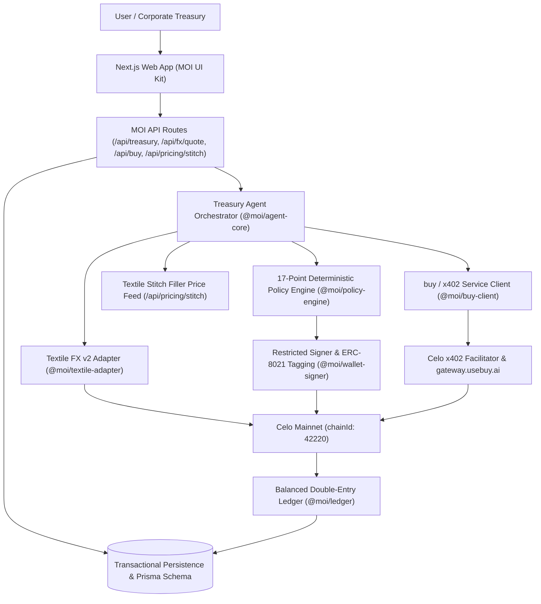

# MOI Architecture & Security Design

## 1. High-Level System Architecture

## 2. Deterministic Policy Boundary (Zero LLM Signing Authority)

In MOI, the LLM/compiler is strictly restricted to:
1. Compiling natural-language user instructions into a draft `TreasuryMandate` that the user explicitly inspects and confirms.
2. Summarizing verified audit events via `cencori.v1.chat.completions`.

Every FX swap must pass all **17 deterministic checks** in `evaluateSwapPolicy` (`packages/policy-engine/src/index.ts`) using exact `BigInt` atomic-unit arithmetic:
1. `MANDATE_NOT_PAUSED`
2. `OPERATING_MODE` (`autonomous` or approved `approval_required`)
3. `NO_DUPLICATE_LOCK` (distributed mandate execution lock)
4. `SIGNER_HEALTHY`
5. `CHAIN_ID_CELO_MAINNET` (`42220`)
6. `FIRM_QUOTE_PRESENT`
7. `TAKER_WALLET_MATCH`
8. `QUOTE_NOT_EXPIRED` (`expiresAt` & `orderDeadline` with safety buffer)
9. `ALLOWLISTED_CORRIDOR` (`cNGN`, `wARS`, `wBRL`, `wCOP`, `wMXN`, `USDC`, `USAT` ↔ `USDT`)
10. `APPROVED_REACTOR_TARGET` (`0xa9AA0a64769cBed4d3B1Ceb4Df01CdE915C235b3`)
11. `CALLDATA_AND_VALUE_GUARD` (`value === "0"` and valid selector)
12. `PER_TRADE_CAP` (`takerPays <= maxTradeAtomic`)
13. `DAILY_SELL_CAP` (`cumulative24h + takerPays <= dailySellCapAtomic`)
14. `MINIMUM_RESERVE_PRESERVED` (`balance - takerPays >= minimumReserveAtomic`)
15. `MIN_BUY_OUTPUT_THRESHOLD`
16. `PROTOCOL_FEE_BOUND` (`<= maxProtocolFeeBps`, Celo Textile is `1 bps`)
17. `DAILY_LOSS_CIRCUIT_BREAKER`

