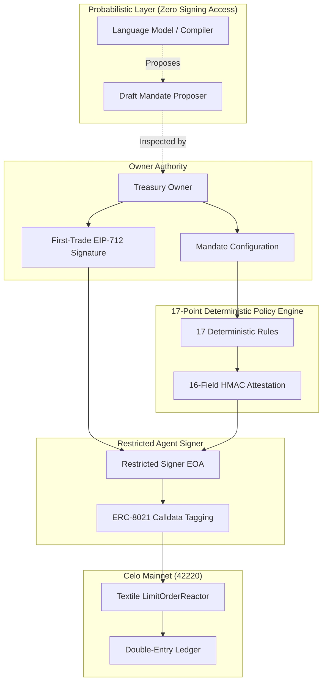

# MOI — Autonomous Treasury Operating System
## Complete Product Documentation & System Reference

> **"Autonomous treasury operations. Within your rules."**

Built for the **Agents on Open Rails Hackathon** (`loops.house/agents-on-open-rails`) on **Celo Mainnet (`chainId: 42220`)**.

---

## 1. System Overview

**MOI** is an autonomous treasury operating system for corporate treasuries operating across emerging markets (Latin America and Africa). It combines an identifiable AI agent on Celo with a deterministic 17-point risk policy engine that enforces institutional guardrails around every trade.

### Key Capabilities
- **Active Taker Mode (`taker_rfq`)**: Continuous automated rebalancing from local fiat currencies (`cNGN`, `wARS`, `wBRL`, `wCOP`) into dollar stablecoins (`USD₮`, `USA₮`, `USDC`) via **Textile FX v2**.
- **Passive Maker Mode (`textile-stitch`)**: Serves an Avellaneda-Stoikov inventory-skewed pricing feed (`/api/pricing/stitch`) so treasuries earn maker spread while balancing reserves.
- **Onchain Identity (ERC-8004)**: Identifiable agent identity hosted at `/api/identity/agent.json` conforming to standard `registration-v1`.
- **Celo Onchain Attribution (ERC-8021)**: 100% of outgoing transactions carry official `@celo/attribution-tags` metadata without mutating calldata semantics.
- **Microservices Settlement (`x402` & `buy`)**: Settles external API intelligence calls (Chainstack, TikHub, Cencori) over HTTP 402 in **USA₮**, **USD₮**, or **USDC**.
- **Double-Entry Accounting**: Balanced ledger where total debits strictly equal total credits down to exact atomic integer units.

---

## 2. Institutional Security Architecture

MOI eliminates the single greatest failure mode of AI in finance: **rogue or unconstrained LLM execution**.



### The 17 Deterministic Policy Rules
1. `MANDATE_NOT_PAUSED`: Mandate must not be paused or revoked.
2. `OPERATING_MODE_PERMITTED`: Checks whether trade is allowed in current mode (`monitor`, `approval_required`, or `autonomous`).
3. `NO_DUPLICATE_EXECUTION_LOCK`: Distributed lock prevents concurrent trade executions on the same mandate.
4. `SIGNER_HEALTH_VERIFIED`: Confirms signer process health and non-empty key reference.
5. `CHAIN_ID_IS_CELO_MAINNET`: Enforces `chainId === 42220`.
6. `FIRM_QUOTE_PRESENT`: Firm quote with executable calldata must exist.
7. `TAKER_WALLET_MATCH`: Quote taker must match configured agent wallet.
8. `QUOTE_NOT_EXPIRED`: Quote `expiresAt` and `orderDeadline` must exceed `now + 1500ms`.
9. `ALLOWLISTED_CORRIDOR`: Only verified tokens (`cNGN`, `wARS`, `wBRL`, `wCOP`, `wMXN`, `USDC`, `USAT`, `USDT`).
10. `APPROVED_REACTOR_TARGET`: Destination must be official Textile `LimitOrderReactor` (`0xa9AA0a64769cBed4d3B1Ceb4Df01CdE915C235b3`).
11. `CALLDATA_AND_VALUE_GUARD`: Transaction native `value` must be `"0"` and selector must be valid.
12. `PER_TRADE_CAP`: Sell amount must not exceed `maxTradeAtomic`.
13. `DAILY_SELL_CAP`: Rolling 24-hour spend plus current trade must not exceed `dailySellCapAtomic`.
14. `MINIMUM_RESERVE_PRESERVED`: Treasury balance minus trade must preserve `minimumReserveAtomic`.
15. `MIN_BUY_OUTPUT_THRESHOLD`: Received buy amount must meet or exceed minimum floor.
16. `PROTOCOL_FEE_BOUND`: Protocol fee must not exceed `maxProtocolFeeBps` (Textile is 1 bps).
17. `DAILY_LOSS_CIRCUIT_BREAKER`: Halts trading if daily realized loss threshold is exceeded.

---

## 3. Verified Celo Mainnet Contracts (`chainId: 42220`)

| Contract / Asset | Address | Description |
| :--- | :--- | :--- |
| **LimitOrderReactor** | `0xa9AA0a64769cBed4d3B1Ceb4Df01CdE915C235b3` | Settlement reactor for Textile FX v2 |
| **Fee Controller** | `0x7b005466F905DD882A959888154587fA76cd3Ea7` | Textile 1 bps fee distributor |
| **Permit2** | `0x000000000022D473030F116dDEE9F6B43aC78BA3` | Canonical Permit2 contract |
| **ERC-8004 Registry** | `0x8004A169FB4a3325136EB29fA0ceB6D2e539a432` | Identity registry on Celo Mainnet |
| **cNGN** | `0xF6829D7393dAe24509eb1E52eE8e572e2E271a4f` | Compliant Naira (6 decimals) |
| **USD₮** | `0x48065fbBE25f71C9282ddf5e1cD6D6A887483D5e` | Tether USD on Celo (6 decimals) |
| **USA₮** | `0xD2ab3C9A02DBBAB236BfEC45D1d755DF4267F771` | America USD on Celo (6 decimals) |
| **USDC** | `0xcebA9300f2b948710d2653dD7B07f33A8B32118C` | Circle USD on Celo (6 decimals) |
| **wARS** | `0x0DC4F92879B7670e5f4e4e6e3c801D229129D90D` | Ripio Argentine Peso (18 decimals) |
| **wBRL** | `0xD76f5Faf6888e24D9F04Bf92a0c8B921FE4390e0` | Ripio Brazilian Real (18 decimals) |
| **wCOP** | `0x8a1D45e102e886510e891d2Ec656a708991e2D76` | Ripio Colombian Peso (18 decimals) |

---

## 4. API Documentation

| Endpoint | Method | Description |
| :--- | :---: | :--- |
| `/api/health` | `GET` | System health, database topology, uptime |
| `/api/health/ready` | `GET` | Readiness probe for container orchestration |
| `/api/health/live` | `GET` | Liveness probe for process monitoring |
| `/api/identity/agent.json` | `GET` | ERC-8004 agent registration document |
| `/api/pricing/stitch` | `GET` | Textile Stitch Avellaneda-Stoikov pricing feed |
| `/api/treasury` | `GET/POST` | Treasury state, live balances, mandate updates |
| `/api/treasury/controls` | `GET/POST` | Approval Queue, pause/resume, audit exports |
| `/api/fx/quote` | `POST` | Live Textile preview and 17-rule evaluation cycle |
| `/api/buy` | `GET/POST` | x402 capability catalog and microservice execution |
| `/api/auth/nonce` | `GET` | Single-use SIWE challenge nonce generation |
| `/api/auth/verify` | `POST` | Server-side cryptographic SIWE signature verification |
| `/api/auth/logout` | `POST` | Server session revocation |

---

## 5. Deployment & Quickstart

```bash
# Clone and enter directory
git clone <repo-url>
cd moi

# Install dependencies
npm install

# Run automated verification suite (202 tests)
npm test

# Run production build (17 routes)
npm run build

# Start production server
npm run start
```

